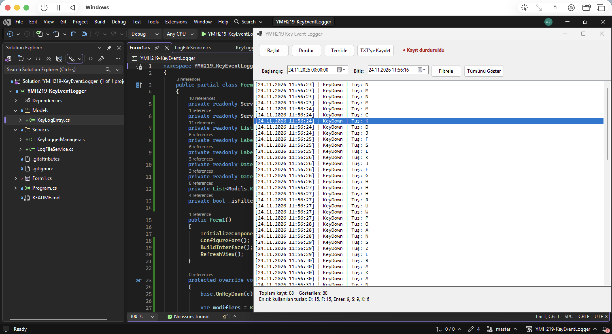
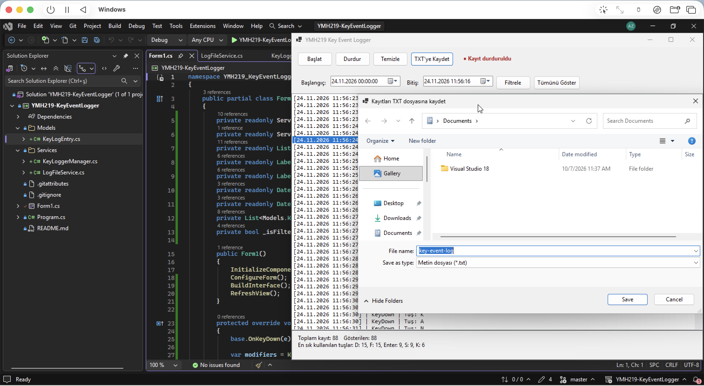
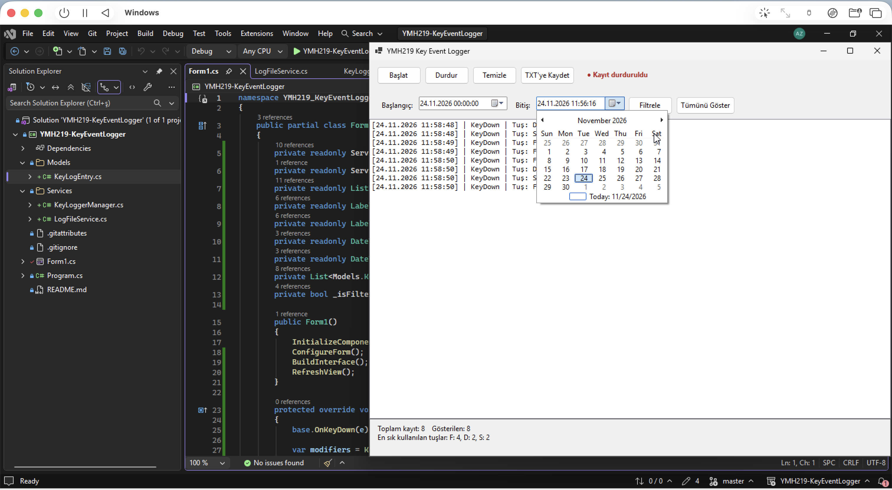

# ⌨️ YMH219 - KeyEventLogger
ر
## 📸 Ekran Görüntüleri

### Ana Ekran ve Olay Kayıtları


### TXT dosyası kaydet


### Başlangıç ve bitiş tarihi


**Nesne Tabanlı Programlama (YMH 219)** dersi kapsamında **C#** ve **.NET 10 Windows Forms** kullanılarak geliştirilen, klavye olaylarını (`KeyDown`, `KeyPress`, `KeyUp`) gerçek zamanlı olarak yakalayan, analiz eden ve kayıt altına alan masaüstü uygulamasıdır.

Bu proje, Windows Forms ortamında olay güdümlü programlama (Event-Driven Programming), klavye olay yaşam döngüsü (Event Lifecycle), `KeyEventArgs` / `KeyPressEventArgs` yapıları ve kullanıcı arayüzü bileşenlerinin dinamik yönetimi gibi temel kavramları uygulamalı olarak göstermek amacıyla geliştirilmiştir.

---

## 🛠️ Kullanılan Teknolojiler ve NuGet Paketleri

* **Programlama Dili:** C#
* **Platform & Framework:** .NET 10 / Windows Forms (WinForms)
* **Olay Yönetimi (Event Handling):** `System.Windows.Forms` (`KeyDown`, `KeyPress`, `KeyUp`, `KeyPreview`)
* **Geliştirme Ortamı (IDE):** Visual Studio Community 2026
* **Sürüm Kontrolü:** Git & GitHub
* **NuGet Paketleri:** Harici bir NuGet paketi kullanılmamıştır. Proje tamamen standart .NET 10 ve Windows Forms kütüphaneleri ile geliştirilmiştir.

---

## 🚀 Kurulum ve Çalıştırma Adımları

Projeyi yerel bilgisayarınızda çalıştırmak için aşağıdaki adımları izleyebilirsiniz:

1. **Gereksinimler:** Bilgisayarınızda **.NET 10 SDK** ve **Visual Studio 2026** (veya uyumlu bir sürüm) yüklü olmalıdır.
2. **Depoyu Klonlayın:**
   ```bash
   git clone [https://github.com/azekra/YMH219-KeyEventLogger.git](https://github.com/azekra/YMH219-KeyEventLogger.git)
   ```
3. **Projeyi Açın:**
   İndirdiğiniz klasör içerisindeki `.sln` (Solution) dosyasını **Visual Studio** ile açın.
4. **Derleyin ve Çalıştırın:**
   Üst menüden **Start** butonuna tıklayın veya klavyeden `F5` tuşuna basarak uygulamayı başlatın.

---

## ✨ Uygulamanın Temel Özellikleri

* **Gerçek Zamanlı Olay Yakalama:** Klavyeden basılan her tuş için `KeyDown`, `KeyPress` ve `KeyUp` olaylarını anlık olarak algılar ve sırasıyla listeler.
* **Detaylı Tuş Bilgisi:** Basılan tuşun adını (`KeyCode`), sayısal kodunu (`KeyValue`), karakter karşılığını (`KeyChar`) ve zaman damgasını (Timestamp) gösterir.
* **Özel Tuş (Modifier) Desteği:** `Ctrl`, `Shift` ve `Alt` gibi kombinasyon tuşlarının durumunu tespit eder.
* **Form Geneli Dinleme:** `KeyPreview = true` özelliği sayesinde odak hangi kontrolde olursa olsun form üzerindeki klavye girişlerini yakalar.
* **Kayıt Yönetimi:** Ekrandaki olay geçmişini tek tıkla temizleme (Clear) özelliği sunar.

---

## 📝 Bilinen Sınırlamalar ve Geliştirme Notları

* **Uygulama İçi Kapsam:** Uygulama yalnızca kendi penceresi aktif (odakta) iken klavye olaylarını kaydeder. Sistem geneli dinleme (Global Keyboard Hook), güvenlik ve ders kapsamı gereği bilinçli olarak eklenmemiştir.
* **Kalıcı Kayıt:** Kaydedilen olaylar şu an yalnızca bellek (RAM) üzerinde tutulmaktadır; uygulama kapatıldığında veriler sıfırlanır. Gelecek sürümlerde `.txt` veya `.csv` formatında dışa aktarma (Export) özelliği eklenebilir.
* **Platform Bağımlılığı:** Windows Forms kullanıldığı için uygulama yalnızca Windows işletim sisteminde çalışmaktadır.

---

## 👨‍💻 Geliştirici Bilgileri

* **Ad Soyad:** [Enes Zukra]
* **Öğrenci Numarası:** [250541616]
